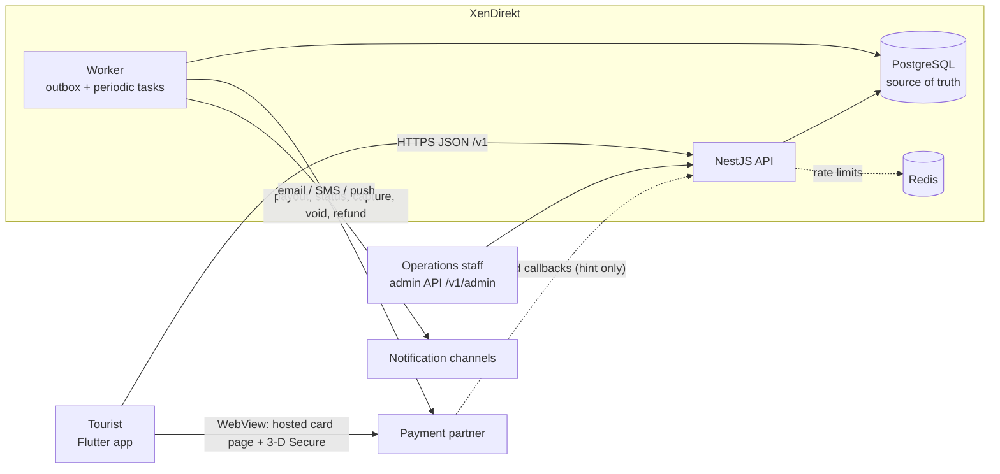
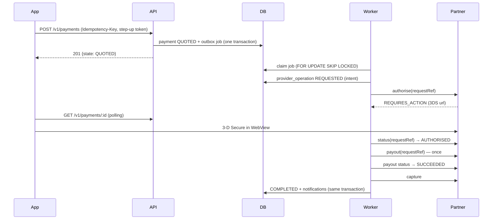

# Architecture

XenDirekt lets an international tourist pay a Rwandan **MTN MoMo** account with a foreign Visa
or Mastercard. The card is held (authorised) first. The seller is paid through a licensed
partner's payout API, and the card is captured only after the payout is confirmed. If the
payout fails, the hold is released.

> **Status:** works end to end against the deterministic **mock provider** only. The one real
> adapter, XentriPay, implements payout and payout status. The card-side capabilities have no
> documented API, so real money cannot move (see `provider-capability-matrix.md`, OQ-01, OQ-08,
> OQ-09, OQ-13).

## System context

- **The app never sees a card number.** Card entry and 3-D Secure happen on the partner's
  hosted pages in a WebView. The API stores only the partner's token (encrypted) and display
  metadata.
- **The provider API key exists only on the backend.**
- **PostgreSQL is the source of truth** for money state, jobs and audit. Redis holds only
  rate-limit counters. Losing it never loses money state.

## Repository layout

| Path | What |
|---|---|
| `api/` | NestJS 12 modular monolith (TypeScript, Node ≥ 24.7). One codebase, two process roles: `api` (HTTP) and `worker` |
| `android-ios/` | Flutter 3.47 app (Riverpod, go_router, Dio) for Android 9+ and iOS 15+ |
| `contracts/fixtures/` | JSON responses recorded by API e2e tests and decoded by Flutter tests: the integration contract |
| `docs/` | This documentation, ADRs, runbooks, traceability, open questions |
| `scripts/live-integration.sh` | Boots the real API and runs the Flutter live test against it |
| `reference-docs/` | Read-only source material (PRD, partner docs) |
| `web/` | Intentionally empty: the admin web UI is out of scope for v1.0 |

## Backend modules (`api/src/modules`)

| Module | Responsibility |
|---|---|
| `auth` | OTP sign-in, JWT access + rotating refresh tokens, PIN (Argon2id + pepper), device keys (Ed25519), step-up grants |
| `users`, `consents` | Profile, legal consents with versions and timestamps, account deletion |
| `admin` | Admin accounts, password + TOTP login, role/permission matrix |
| `cards` | Hosted card setup, eligibility (Rwandan-issued, prepaid, BIN blocklist), max 3 cards |
| `payees` | MTN number normalisation, name lookup, recent payees |
| `quotes` | Fee + FX calculation in integer minor units, limits, 5-minute validity |
| `payments` | State machine, transitions, orchestrator (provider jobs), user and admin views, review actions |
| `refunds` | Maker-checker refunds, capability-gated execution, manual completion with evidence |
| `reconciliation` | Daily status-API reconciliation, provisional settlement-file import, items, CSV export |
| `webhooks` | Partner callbacks: verified, deduplicated, and only ever trigger a status poll |
| `risk` | Rules (velocity, card on many accounts, many payers to a new payee), blocklist, flag review |
| `provider` | Port, capability gateway, mock provider and dev hosted pages, XentriPay adapter |
| `notifications` | In-app inbox, email/SMS ports, templates (EN/FR/RW draft), delivery jobs |
| `tickets`, `analytics`, `configuration`, `audit`, `health` | Support, PII-free events, versioned config, append-only audit, health/metrics |

Cross-cutting code: `common/` (errors, logging with redaction, guards, pipes), `jobs/`
(outbox, dispatcher, periodic tasks), `shared/` (money, phone, crypto, clock).

## Processing model

- **Transactional outbox (ADR 0003).** State change and next job are committed together.
  Jobs are claimed with `FOR UPDATE SKIP LOCKED` and a lease. They retry with exponential
  backoff and jitter, and go `DEAD` after the maximum attempts. Dedupe keys stop the same job
  from being queued twice while one is live.
- **Periodic tasks** run under PostgreSQL advisory locks, so only one worker runs each:
  - the payment sweeper, every 30 s
  - daily reconciliation, checked hourly
- `WORKER_MODE`:
  - `separate`: the deployed default, a dedicated `worker` process
  - `inline`: local and test only
  - `disabled`: tests drive the dispatcher by hand

## Provider boundary (ADR 0004)

Application code calls the partner only through `ProviderGateway`. A capability is *usable*
only when:

1. the adapter implements it, **and**
2. either it is simulated (mock, never in production), or `PROVIDER_CAPABILITY_APPROVALS`
   lists it with an evidence reference.

Production refuses to start when any critical capability lacks approval (`startup-guards.ts`).
An unusable capability fails with `CAPABILITY_NOT_CONFIGURED`. Nothing is faked.

## Mobile app (`android-ios/lib`)

Feature folders hold `data/` (API clients and models), `application/` (Riverpod controllers)
and `presentation/` (screens). `core/` holds:

- the networking client: queued token refresh, certificate-pinning hook, error mapping
- secure storage
- biometrics, device keys, app lock and screen security
- the hosted-page WebView launcher
- the motion kit

The router redirects on session state: signed out, pending profile, PIN missing, locked, or
ready. Payments are created with an app-generated idempotency key. The app resumes the same
attempt with the same key after a crash or a network loss.

## Key decisions

See `docs/adr/`:

- 0001: stack and modular monolith
- 0002: Kysely with explicit SQL
- 0003: outbox
- 0004: capability boundary
- 0005: auth and step-up
- 0006: money and rounding
- 0007: state machine extensions
- 0008: MTN-only routing
