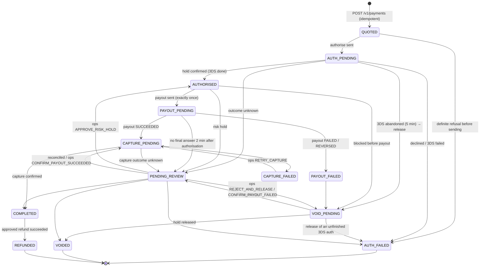

# Payment state machine

Source of truth: `api/src/modules/payments/domain/payment-state-machine.ts` (`TRANSITIONS`).
Every state change goes through `PaymentTransitionsService.transition`. That method calls
`assertTransition`, writes an append-only `payment_events` row, stamps the state's timestamp
column and notifies listeners (notifications, analytics), all in the caller's database
transaction. Unit tests cover every pair of states (`api/test/unit/domain/payment-state-machine.spec.ts`).

The PRD's states keep their PRD meaning. Three internal states were added (ADR 0007):

- `CAPTURE_PENDING`: the payout is confirmed and the capture has not been confirmed yet.
- `CAPTURE_FAILED`: the payout succeeded but the capture failed. The seller has the money;
  operations must collect it. A second payout is never attempted.
- `VOID_PENDING`: the hold release has been requested and not yet confirmed.

## Diagram

## What the tourist sees

`payment-view-model.ts` maps each state to the app's `status` and `chargeStatus`:

| State | status | chargeStatus |
|---|---|---|
| QUOTED | PROCESSING | NOT_CHARGED |
| AUTH_PENDING | ACTION_REQUIRED (3-D Secure page waiting) or PROCESSING | NOT_CHARGED |
| AUTHORISED | PROCESSING | HOLD |
| PAYOUT_PENDING | SENT | HOLD |
| CAPTURE_PENDING | RECEIVED | HOLD |
| COMPLETED | COMPLETED | CHARGED |
| AUTH_FAILED | FAILED | NOT_CHARGED |
| PAYOUT_FAILED, VOID_PENDING | FAILED | HOLD_RELEASING |
| VOIDED | FAILED | NOT_CHARGED |
| CAPTURE_FAILED | IN_REVIEW | UNKNOWN |
| PENDING_REVIEW | IN_REVIEW | HOLD for a risk hold, otherwise UNKNOWN |
| REFUNDED | REFUNDED | REFUNDED |

The copy in both languages ("You have not been charged", "We are checking this payment. You
will not be charged twice") lives in the app's ARB files and is keyed off these two fields.

The app never derives success from an HTTP 200 or a `PENDING`. It shows only what the server
reports.

## Money-safety rules (enforced in code and by the database)

1. **Write intent first.** A `provider_operations` row (unique `request_ref`) is committed
   *before* every provider call. Recovery always reads status by that reference.
2. **Re-send only when the request was certainly not sent.** That means the HTTP client failed
   before sending (`ProviderUnreachableError` with `NOT_SENT`). Every other failure, such as a
   timeout or a 5xx after sending, is *ambiguous*. The worker then polls status and never re-sends.
3. **Exactly one payout per payment.** The partial unique index
   `ux_operations_single_payout` and an e2e test (`the database refuses a second payout`) enforce it.
4. **Capture only after a confirmed payout.** `CAPTURE_PENDING` is reachable only from a payout
   `SUCCEEDED` result, or from an operations confirmation recorded with evidence.
5. **A failed payout releases the hold automatically**: `PAYOUT_FAILED → VOID_PENDING → VOIDED`.
6. **A payout reversed after success** is recorded as a `PAYOUT_REVERSAL` adjustment with an
   alert. The payment state is not flipped silently.
7. **Idempotent creation.** `(user_id, idempotency_key)` is unique. A replay with the same body
   returns the same payment. A different body under the same key returns `IDEMPOTENCY_KEY_REUSED`.
   The key is re-checked under the user's row lock to close the concurrent-request race.

## Timers

| Timer | Value | Code |
|---|---|---|
| 3-D Secure abandonment | 5 min from `auth_pending_at` → release | `AUTH_TIMEOUT_MS` |
| Review clock (FR-EXE-05) | 2 min from **authorisation** with no final payout answer → `PENDING_REVIEW` | `REVIEW_AFTER_MS` (OQ-22) |
| Review reconciliation | Status re-check every 30 s, doubling to 15 min; alert `REVIEW_UNRESOLVED_24H` after 24 h | `reconcileReview` |
| Sweeper | Every 30 s re-enqueues the driving job of in-flight payments (dedupe makes it a no-op) | `payment-sweeper.task.ts` |

The review clock starts at authorisation, not at creation. A 3-D Secure challenge can
legitimately take several minutes, and starting the clock at creation would send healthy
payments to review (OQ-22).

## Review reasons

`RISK_HOLD`, `NO_FINAL_STATE_2MIN`, `AUTH_OUTCOME_UNKNOWN`, `PAYOUT_OUTCOME_UNKNOWN`,
`CAPTURE_OUTCOME_UNKNOWN`, `VOID_FAILED`, `PAYOUT_REVERSED_AFTER_SUCCESS`.

Outcome-unknown reasons are reconciled automatically by status polling. `RISK_HOLD` waits for
an analyst (`APPROVE_RISK_HOLD` or `REJECT_AND_RELEASE`).

## Operations actions (`POST /v1/admin/payments/:id/actions`)

| Action | Allowed when | Effect |
|---|---|---|
| `APPROVE_RISK_HOLD` | PENDING_REVIEW + RISK_HOLD, authorisation succeeded, no payout yet | → AUTHORISED, payout job |
| `REJECT_AND_RELEASE` | PENDING_REVIEW without a payout sent | → VOID_PENDING, void job |
| `CONFIRM_PAYOUT_SUCCEEDED` | PENDING_REVIEW with an existing payout operation, after checking with the partner | → CAPTURE_PENDING, capture job |
| `CONFIRM_PAYOUT_FAILED` | Same, when the partner confirms failure | → VOID_PENDING, void job |
| `RETRY_CAPTURE` | CAPTURE_FAILED | → CAPTURE_PENDING, capture job |

Every action requires a reason, is audited (`payment.review.<action>`) and records a
`payment_events` row with `source = OPS`. No action can send a second payout.
