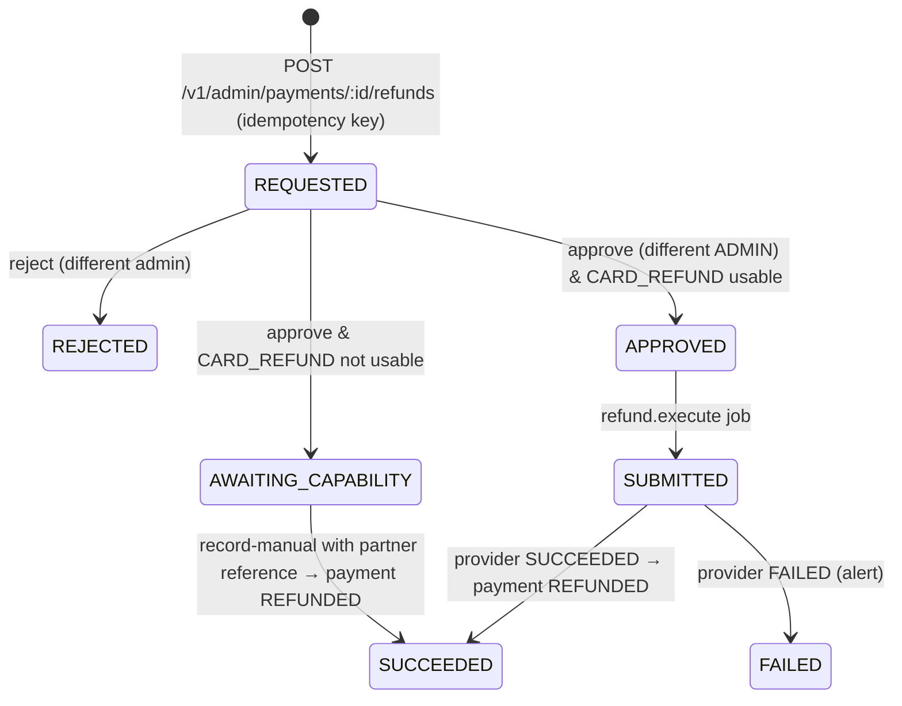

# Refunds, voids, reversals and reconciliation

Four different events can return or move money after a payment starts. Each is its own
`payment_adjustments` record. They are never conflated (e2e scenario 13).

| Type | When | Who starts it | Record |
|---|---|---|---|
| **Void** | Before capture: the payout failed, the risk hold was rejected, or 3-D Secure was abandoned | The orchestrator, automatically | `VOID` adjustment + `VOIDED` state. The tourist was **not charged**. |
| **Refund** | After capture (`COMPLETED`) | An operations request, approved by a different Admin | `REFUND` adjustment, then `REFUNDED` state once it succeeds |
| **Payout reversal** | The partner reports a payout reversed after it succeeded | Provider status or reconciliation | `PAYOUT_REVERSAL` adjustment + `PAYOUT_REVERSED` alert. The state is not changed silently. |
| **Chargeback** | The card network disputes the charge | Partner feed | **Not implemented.** No partner feed exists. |

## Refund workflow (FR-ADM-03, OQ-12, OQ-25)



- **Who can do what:**
  - Support agents, risk analysts and admins can **request** a refund.
  - Only `ADMIN` can approve or reject, and never their own request. This is checked in the
    service (`MAKER_CHECKER_VIOLATION`) and by a database CHECK.
- **Amount:** only full refunds of the card total, in the card currency. Partial refunds are
  not supported in v1.0.
- **Duplicates:** at most one live refund per payment (partial unique index). Requests are
  idempotent by key.
- **No double refund:**
  - `SUBMITTED` is written **before** the provider call.
  - If the job runs again while a refund is `SUBMITTED`, it does **not** call the provider. It
    raises `REFUND_OUTCOME_UNKNOWN` for operations.
  - The status goes back to `APPROVED` only when the request certainly never left
    (`ProviderUnreachableError`).
- **Without a refund API** (XentriPay today):
  - the approved refund waits in `AWAITING_CAPABILITY` and raises `REFUND_NEEDS_MANUAL_HANDLING`;
  - operations refund in the partner's portal, then call `record-manual` with the partner's
    reference as evidence;
  - nothing is marked refunded without that evidence.

## Reconciliation (FR-ADM-06, OQ-14)

Reconciliation compares our `provider_operations` with the partner's view for one **Kigali
business date** (UTC+2, no DST). It **never changes a payment**. Each difference becomes a
`reconciliation_items` row for operations to resolve with a note. Fixes go through the audited
review actions or refunds.

### Sources

1. **Status API** (`POST /v1/admin/reconciliation/runs`, plus a daily automatic run for
   yesterday, checked hourly under an advisory lock).
   - Every `PAYOUT` and `CAPTURE` operation requested that day is re-queried by its request
     reference.
   - Match states: `MATCHED`, `STATUS_MISMATCH`, `MISSING_AT_PROVIDER`, `REVERSAL`.
   - A reversed payout also writes a `PAYOUT_REVERSAL` adjustment, once.
2. **Settlement file** (`POST /v1/admin/reconciliation/settlement-files`, JSON body holding the
   CSV text, up to 6 MB and 50,000 rows).
   - Adds `AMOUNT_MISMATCH`, `CURRENCY_MISMATCH` and `MISSING_INTERNAL`.
   - A file with the same SHA-256 is refused once it has been imported.

### Settlement CSV: provisional layout

No partner settlement format exists yet. This layout is ours and will be replaced by an adapter
once the partner's report format is known.

```
client_reference,provider_reference,amount_minor,currency,status
XD-7KQ2M9-PO,P-118273,12000,RWF,SUCCEEDED
```

- `client_reference` is our `provider_operations.request_ref`.
- `amount_minor` is an integer in minor units.
- `status` is one of `SUCCEEDED`, `FAILED` or `REVERSED`.
- Any invalid row rejects the whole file. Nothing is partially imported.

### Working the items

- `GET  /v1/admin/reconciliation/runs/:id/items?unresolved=true`
- `PATCH /v1/admin/reconciliation/items/:id` with `{status: RESOLVED | NOT_APPLICABLE, note}`.
  This needs `reconciliation:manage` and is audited.
- `GET  /v1/admin/reconciliation/runs/:id/export.csv` for finance. It contains no personal data,
  and spreadsheet formulas are neutralised.

Matched items are stored as `NOT_APPLICABLE`, so only real differences need attention. Any
mismatch logs `RECONCILIATION_MISMATCH`. A failed run logs `RECONCILIATION_FAILED`. See
`runbooks/reconciliation-mismatch.md`.

## Open points

- OQ-12: how XentriPay or a future partner performs card refunds.
- OQ-14: settlement report format and correlation keys.
- OQ-16: payout fee semantics.
- OQ-17: the wallet funding model.
- Chargebacks need a partner feed.
- Partial refunds are a product decision.
